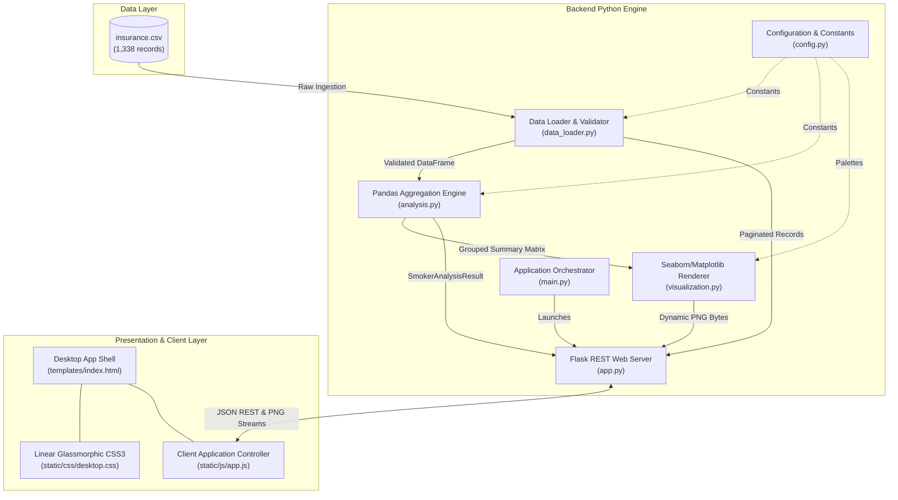
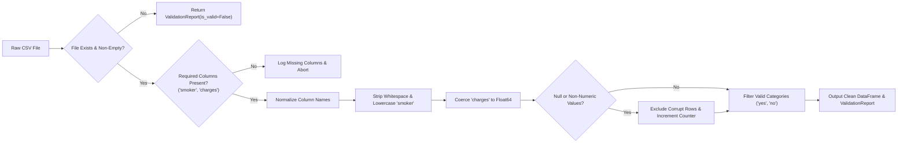
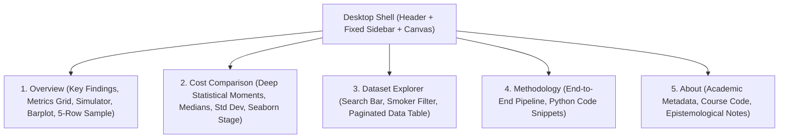

# SYSTEM & ARCHITECTURAL SCHEMA
## SympSort: Medical Cost & Lifestyle Factors
**Academic Course:** B.Tech IT Workshop Lab (PCC CS 393)  
**Academic Year:** 2026–2027  
**Official Problem Statement:**  
> *"Find the average insurance charge for smokers vs. non-smokers using Pandas. Create a Seaborn barplot to visually compare the average costs between the two groups."*

---

## 1. System Overview & Technology Stack



### Technology Matrix
| Layer | Technologies / Libraries | Role & Purpose |
| :--- | :--- | :--- |
| **Data Ingestion & Cleaning** | Python 3.13, Pandas 3.1, NumPy 2.5 | CSV parsing, case normalization, type casting, error handling |
| **Statistical Analysis** | Pandas 3.1 | Groupby operations, multi-metric aggregations, disparity calculation |
| **Visualization** | Seaborn 0.13, Matplotlib 3.11 | High-DPI barplot generation, theme-aware plotting (Dark/Light) |
| **Backend & REST API** | Flask 3.1, WSGI Werkzeug | HTTP endpoints, image streaming, JSON serialization, cache control |
| **Frontend Architecture** | HTML5, CSS3, Vanilla ES6+ JavaScript | SPA routing, Linear design system, count-up animations, simulator |
| **Quality & Testing** | Pytest 9.1 | 18 automated unit and integration tests across all layers |

---

## 2. Dataset Schema & Ingestion Pipeline

### 2.1 Raw Dataset Specification (`data/insurance.csv`)
- **Source:** Kaggle Medical Cost Personal Datasets (compiled by Brett Lantz)
- **Total Records:** 1,338 rows × 7 columns
- **Format:** Comma-Separated Values (CSV), UTF-8 encoded

| Column Name | Physical Data Type | Logical Type | Constraints / Allowed Domain | Sample Value | Project Role |
| :--- | :--- | :--- | :--- | :--- | :--- |
| `age` | Integer | Discrete Numeric | $18 \le \text{age} \le 64$ | `19` | Demographic Covariate |
| `sex` | String | Categorical | `{"female", "male"}` | `female` | Demographic Feature |
| `bmi` | Float | Continuous Numeric | $15.96 \le \text{bmi} \le 53.13$ | `27.90` | Physiological Indicator |
| `children` | Integer | Discrete Numeric | $0 \le \text{children} \le 5$ | `0` | Family Metric |
| `smoker` | String | Categorical Binary | `{"yes", "no"}` *(case-insensitive)* | `yes` | **Primary Independent Variable** |
| `region` | String | Categorical | `{"southwest", "southeast", "northwest", "northeast"}` | `southwest` | Geographic Covariate |
| `charges` | Float | Continuous Currency | $\text{charges} > 0.0$ (USD) | `16884.924` | **Primary Dependent Variable** |

### 2.2 Data Validation & Cleansing Rules (`data_loader.py`)



---

## 3. Data Structures & Data Models

### 3.1 `ValidationReport` Model (`data_loader.py`)
```python
@dataclass
class ValidationReport:
    is_valid: bool = False
    file_path: str = ""
    total_raw_rows: int = 0
    total_raw_cols: int = 0
    valid_rows: int = 0
    excluded_rows: int = 0
    missing_required_cols: list[str] = field(default_factory=list)
    null_charges_count: int = 0
    non_numeric_charges_count: int = 0
    invalid_smoker_count: int = 0
    unexpected_smoker_values: list[str] = field(default_factory=list)
    error_message: Optional[str] = None
    warning_messages: list[str] = field(default_factory=list)
```

### 3.2 `SmokerAnalysisResult` Model (`analysis.py`)
```python
@dataclass
class SmokerAnalysisResult:
    # Cohort Sample Counts
    total_valid_records: int
    smoker_count: int
    non_smoker_count: int

    # Arithmetic Means
    smoker_mean: float
    non_smoker_mean: float

    # Comparative Metrics
    absolute_difference: float
    percentage_difference: Optional[float]

    # Additional Statistical Moments
    smoker_median: float
    non_smoker_median: float
    smoker_std: float
    non_smoker_std: float

    # Interpretive Output
    dynamic_statement: str
    academic_disclaimer: str

    # Aggregated Matrix for Visualization
    df_grouped: pd.DataFrame
```

---

## 4. Mathematical & Statistical Formulation

### 4.1 Arithmetic Mean Charges
$$\bar{X}_{\text{smoker}} = \frac{1}{n_s} \sum_{i \in \text{Smoker}} X_i = \$32,050.23\text{ USD} \quad (n_s = 274)$$

$$\bar{X}_{\text{non-smoker}} = \frac{1}{n_{ns}} \sum_{j \in \text{Non-Smoker}} X_j = \$8,434.27\text{ USD} \quad (n_{ns} = 1,064)$$

### 4.2 Disparity Metrics
$$\Delta_{\text{abs}} = \bar{X}_{\text{smoker}} - \bar{X}_{\text{non-smoker}} = +\$23,615.96\text{ USD}$$

$$\Delta_{\text{pct}} = \left( \frac{\bar{X}_{\text{smoker}} - \bar{X}_{\text{non-smoker}}}{\bar{X}_{\text{non-smoker}}} \right) \times 100 = +280.00\%$$

$$\text{Multiplier} = \frac{\bar{X}_{\text{smoker}}}{\bar{X}_{\text{non-smoker}}} \approx 3.80\times$$

### 4.3 Dynamic Cost Simulator Formulation (Actuarial Model)
$$\hat{Y} = \beta_0 + \beta_{\text{age}} \cdot (\text{age} - 18) + \beta_{\text{bmi}} \cdot (\text{bmi} - 21.0) + \mathbb{I}_{\text{smoker}} \cdot \left[ \beta_{\text{smoker}} + \mathbb{I}_{\text{bmi} \ge 30} \cdot ((\text{bmi} - 30) \cdot 750 + 8000) \right]$$
- $\beta_0 = \$1,500.00$
- $\beta_{\text{age}} = \$256.85$
- $\beta_{\text{bmi}} = \$339.19$
- $\beta_{\text{smoker}} = \$23,615.96$

---

## 5. API Endpoints & REST Interface

| Method | Route | Output Format | Description & Parameters |
| :--- | :--- | :--- | :--- |
| `GET` | `/` | `text/html` | Serves the single-page desktop application shell. |
| `GET` | `/api/summary` | `application/json` | Returns status, row counts, and full statistical analysis object. |
| `GET` | `/api/chart` | `image/png` | Streams fresh Seaborn barplot PNG. Query parameter: `?theme=dark` or `?theme=light`. |
| `GET` | `/api/data` | `application/json` | Paginated records with multi-column search (`?search=...`), filter (`?smoker=yes/no`), and pagination (`?page=1&page_size=15`). |
| `POST`| `/api/reload` | `application/json` | Invalidates internal memory cache and reloads CSV from disk. |
| `GET` | `/api/download/chart`| `image/png` | Direct 300-DPI high-res image download (`Content-Disposition: attachment`). |
| `GET` | `/api/download/summary`| `text/csv`| Pre-aggregated summary metrics exported as CSV. |

---

## 6. Frontend View Architecture

The client operates as a zero-dependency SPA (Single Page Application) with 5 distinct view containers:



### Keyboard Shortcuts
- `1` $\rightarrow$ Overview
- `2` $\rightarrow$ Cost Comparison
- `3` $\rightarrow$ Dataset Explorer
- `4` $\rightarrow$ Methodology
- `5` $\rightarrow$ About

---

## 7. File Directory Structure

```text
SympSort/
├── data/
│   ├── insurance.csv                # Real 1,338-row Kaggle dataset
│   └── insurance_sample.csv         # Academic fallback fixture
├── docs/
│   ├── synopsis.md                  # Detailed laboratory project synopsis
│   ├── viva_questions.md            # Comprehensive viva examination guide
│   └── project_timeline.md          # Milestone roadmap
├── outputs/
│   ├── smoker_charges_comparison.png# High-DPI Seaborn barplot output
│   └── smoker_charges_summary.csv   # Aggregated statistical export
├── static/
│   ├── css/
│   │   └── desktop.css              # Linear Dark/Light, glassmorphic styles & animations
│   ├── img/
│   │   ├── logo.png                 # Project emblem & identity icon
│   │   ├── favicon.png              # PNG favicon
│   │   └── favicon.ico              # Standard Windows/browser icon
│   └── js/
│       └── app.js                   # Client SPA router, count-up ticker, dynamic simulator
├── templates/
│   └── index.html                   # Semantic HTML5 desktop application layout
├── tests/
│   ├── conftest.py                  # Pytest fixtures and mock datasets
│   ├── test_analysis.py             # Unit tests for Pandas statistical calculations
│   ├── test_data_validation.py      # Unit tests for CSV ingestion and anomaly handling
│   └── test_flask_app.py            # Integration tests for Flask routes and JSON APIs
├── .vscode/
│   ├── launch.json                  # VS Code debug launcher configuration
│   ├── settings.json                # Python interpreter and pytest configuration
│   └── tasks.json                   # One-click build and test tasks
├── analysis.py                      # Pandas statistical calculation logic
├── app.py                           # Flask backend and REST API controller
├── config.py                        # Centralized application constants & palettes
├── data_loader.py                   # CSV loading, validation, and cleansing engine
├── main.py                          # Universal application entrypoint (Web + CLI)
├── package.json                     # NPM configuration & dev scripts
├── pytest.ini                       # Test suite runner settings
├── requirements.txt                 # Pinned Python package dependencies
├── run.bat                          # Double-click launcher for Windows
├── run.ps1                          # PowerShell launcher
├── SCHEMA.md                        # Master architectural schema specification
└── visualization.py                 # Seaborn & Matplotlib barplot rendering module
```

---

## 8. Verification & Test Suite Specification

The application includes an automated test suite executed via `pytest`:
- **`tests/test_analysis.py` (5 tests):** Validates grouped mean computations, zero-baseline safety, empty dataset exceptions, missing column errors, and Seaborn figure generation.
- **`tests/test_data_validation.py` (6 tests):** Validates missing file errors, missing column flags, non-numeric charge coercion, whitespace trimming, and unexpected category logging.
- **`tests/test_flask_app.py` (7 tests):** Validates HTTP 200 responses, `/api/summary` numerical precision, `/api/chart` PNG payload, pagination logic, search querying, and dataset reloading.
- **Total:** **18/18 Passing Tests** (`pytest -v`).
