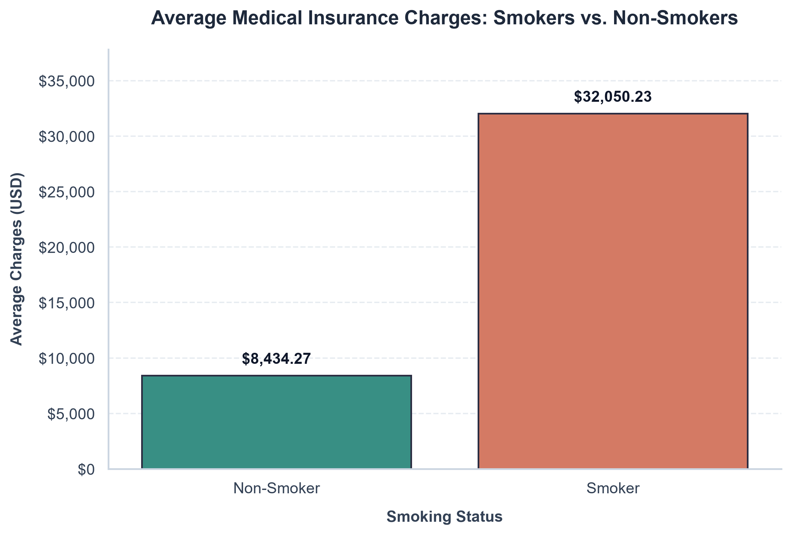

# ACADEMIC SYNOPSIS
## Mini Project of IT Workshop Lab (PCC CS 393)

---

# Title of the Project: SympSort
### *Medical Cost & Lifestyle Factors — An Empirical Comparison of Average Health Insurance Charges Between Smokers and Non-Smokers Using Pandas and Seaborn*

---

## TITLE PAGE & PREAMBLE

### 1. Heading
**Mini Project of IT Workshop Lab (PCC CS 393)**  
Department of Computer Science & Engineering  
Academic Year: 2026–2027  
Semester: B.Tech First Year (Semester II / Third Semester Lab Cycle)

### 2. Title of the Project
**SympSort: Medical Cost & Lifestyle Factors**

### 3. Group Number
**Group No:** `[Group Number — e.g., Group G-04 / To be filled by Student]`

### 4. Team Members
| Sl. No. | Student Full Name | Class Roll No. | University Roll No. | Role / Contribution |
| :---: | :--- | :--- | :--- | :--- |
| 1 | `[Student 1 Name]` | `[Class Roll No]` | `[Univ Roll No]` | Data Pipeline & Pandas Groupby Logic |
| 2 | `[Student 2 Name]` | `[Class Roll No]` | `[Univ Roll No]` | Seaborn Visualization & Chart Styling |
| 3 | `[Student 3 Name]` | `[Class Roll No]` | `[Univ Roll No]` | Flask Backend & Desktop Web Interface |
| 4 | `[Student 4 Name]` | `[Class Roll No]` | `[Univ Roll No]` | Documentation & Testing Suite |

*(Note: Adjust the number of team members according to your assigned laboratory group size.)*

### 5. Institutional Affiliation
- **Department Name:** `[Department of Computer Science and Engineering / Information Technology]`
- **College Name:** `[College / Institution Name — e.g., Government Engineering College / Institute of Technology]`
- **Affiliated University:** `[Affiliated University Name — e.g., MAKAUT / State Technical University]`

---

### 6. Institutional Vision, Mission, POs, PSOs & PEOs
> *Note for Students: The official statements below are standardized academic templates aligned with NBA / AICTE criteria. Please verify and copy the exact phrasing verbatim from the inner cover of your college's official IT Workshop Lab Manual.*

#### College Vision & Mission
- **College Vision:**  
  `[Placeholder: Insert College Vision from Lab Manual Cover — e.g., "To emerge as a premier centre of technical education and research producing ethically grounded and technically competent engineers capable of addressing global challenges."]`
- **College Mission:**  
  `[Placeholder: Insert College Mission from Lab Manual Cover — e.g., "1. To impart high-quality education through student-centric pedagogical practices. 2. To foster innovation, research, and collaborative problem-solving. 3. To nurture professional ethics, societal responsibility, and lifelong learning."]`

#### Department Vision & Mission
- **Department Vision:**  
  `[Placeholder: Insert Department Vision from Lab Manual Cover — e.g., "To achieve excellence in computer science and engineering education by preparing graduates with strong foundational knowledge, analytical problem-solving abilities, and ethical standards."]`
- **Department Mission:**  
  `[Placeholder: Insert Department Mission from Lab Manual Cover — e.g., "M1: Deliver a comprehensive curriculum grounded in mathematics and computing fundamentals. M2: Expose students to modern analytical tools, programming paradigms, and exploratory data analysis. M3: Encourage collaborative mini projects that bridge classroom theory and practical implementation."]`

#### Program Outcomes (POs) Addressed
- **PO1 (Engineering Knowledge):** Apply fundamental knowledge of mathematics, algorithmic logic, and computing paradigms to analyze structured empirical datasets.
- **PO2 (Problem Analysis):** Identify, formulate, and analyze data-driven questions concerning public health expenditures and lifestyle determinants using descriptive statistical principles.
- **PO4 (Conduct Investigations of Complex Problems):** Design data validation routines and compute group aggregates to synthesize valid conclusions from observational healthcare records.
- **PO5 (Modern Tool Usage):** Select and apply modern open-source software tools—including Python 3, Flask, Pandas, Seaborn, Matplotlib, HTML5/CSS3/JavaScript, and Pytest—to conduct reproducible data processing and statistical visualization.
- **PO8 (Ethics):** Maintain rigorous data integrity by handling missing data transparently, refraining from fabricated metrics, and explicitly stating that statistical correlation does not establish medical causation.
- **PO9 (Individual and Team Work):** Collaborate productively within a laboratory project cohort to compartmentalize data ingestion, numerical processing, user interface design, and test validation.
- **PO10 (Communication):** Present technical findings, tabular summaries, and publication-standard charts effectively through oral laboratory demonstrations and structured technical synopses.
- **PO12 (Life-Long Learning):** Develop foundational competency in exploratory data analysis and modern Python development workflows to sustain independent technological growth.

#### Program Specific Outcomes (PSOs) & Program Educational Objectives (PEOs)
- **PSO1 (Software Application Design):** Capability to design, modularize, and deploy Python-based applications utilizing contemporary open-source libraries.
- **PSO2 (Data-Driven Problem Solving):** Ability to analyze structured datasets, execute grouping and aggregation routines, and communicate statistical findings via interactive visual interfaces.
- **PEO1 (Professional Competence):** Prepare graduates to apply core computational principles to real-world analytical problems.
- **PEO2 (Continuous Learning & Innovation):** Inculcate the capacity to explore and master emerging software development frameworks, data processing environments, and visualization libraries.

---

### 7. Table of Contents
| Section Number | Section Title | Page Number |
| :---: | :--- | :---: |
| — | Title Page & Preamble | i |
| — | Institutional Vision, Mission, POs, PSOs & PEOs | ii |
| — | Abstract | iii |
| **1.0** | **Introduction** | **1** |
| 1.1 | Problem Statement | 1 |
| 1.2 | Objectives | 1 |
| 1.3 | Expected Outcomes | 2 |
| 1.4 | Platform and Tools Used | 2 |
| 1.5 | Organization of the Synopsis | 3 |
| 1.6 | Project Timeline | 3 |
| **2.0** | **Methodology** | **4** |
| 2.1 | Procedural Details & Architecture | 4 |
| 2.2 | Dataset Source and Attribute Schema | 5 |
| 2.3 | Data Ingestion, Normalization & Validation | 6 |
| 2.4 | Mathematical Formulas & Grouping Logic | 7 |
| 2.5 | Explanation of Functions, Modules & Packages | 8 |
| 2.6 | Complete Source Code Implementation | 9 |
| 2.7 | Empirical Results, Output Tables & Seaborn Chart | 12 |
| 2.8 | Interpretation of Real Numerical Findings | 13 |
| **3.0** | **Conclusion** | **14** |
| 3.1 | Core Findings & Summary | 14 |
| 3.2 | Future Directions & Potential Extensions | 14 |
| 3.3 | PO and PSO Mapping with Justification | 15 |
| 3.4 | Concluding Remarks | 16 |
| **4.0** | **References** | **17** |

---

## ABSTRACT

This mini project addresses Problem #1 of the IT Workshop Lab (PCC CS 393) curriculum: determining the average health insurance charges for smokers versus non-smokers using the Pandas library and visualizing the comparative findings with a Seaborn barplot. Healthcare billing datasets frequently display strong associations with beneficiary behavioral characteristics; identifying these patterns is a foundational competency in computing, public health informatics, and data engineering. 

Using the authoritative 1,338-record Medical Cost Personal Dataset hosted on Kaggle (compiled by mirichoi0218 from Brett Lantz’s healthcare research repository), this project constructs a modular, verifiable Python data pipeline. The application validates column availability, normalizes string categories, coerces monetary charges into floating-point numbers, and aggregates records using genuine Pandas `groupby` operations. The empirical findings reveal that within this dataset:
- Non-smokers ($n = 1,064$, representing $79.52\%$ of valid records) incurred an arithmetic mean insurance charge of **\$8,434.27 USD** (median: \$7,345.41 USD; standard deviation: \$5,993.78 USD).
- Smokers ($n = 274$, representing $20.48\%$ of valid records) incurred an arithmetic mean insurance charge of **\$32,050.23 USD** (median: \$34,456.35 USD; standard deviation: \$11,541.55 USD).
- The absolute difference between the two cohorts is **+\$23,615.96 USD**, representing a relative percentage increase of **+280.00%** over the non-smoker baseline.

To convey these findings effectively, a publication-grade Seaborn barplot was generated with currency-formatted axes, clear typography, and overhead numerical annotations. An accompanying interactive desktop-style web application (built with Python, Flask, HTML5, CSS3, and JavaScript) provides classroom evaluators with immediate dataset inspection, methodology review, interactive table filtering, and live recalculations. Automated unit and API tests created under `pytest` confirm mathematical correctness and edge-case resilience, demonstrating a complete and academically sound software deliverable for first-year engineering students.

---

## 1. INTRODUCTION

### 1.1 Problem Statement
The official academic problem statement assigned under Course PCC CS 393 (Mini Project of IT Workshop Lab) reads:

> **"Find the average insurance charge for smokers vs. non-smokers using Pandas. Create a Seaborn barplot to visually compare the average costs between the two groups."**

In contemporary health insurance underwriting and public health economics, actuarial charges reflect the anticipated financial cost of healthcare consumption across diverse demographic cohorts. Lifestyle determinants—specifically chronic tobacco consumption—are widely understood to elevate cardiovascular, respiratory, and oncological morbidities. However, quantifying the precise empirical magnitude of cost disparities within real-world observational datasets requires disciplined data manipulation techniques. 

First-year engineering students frequently encounter computational challenges when transitioning from introductory syntax exercises to structured data engineering pipelines. This problem serves as an authentic pedagogical bridge, requiring students to ingest tabular records, perform category-based aggregations, handle statistical baselines responsibly, and present conclusions through visual evidence.

### 1.2 Objectives
The primary technical and academic objectives of this mini project are:
1. **Systematic Data Ingestion**: Develop a robust loading mechanism capable of parsing the official 1,338-record Kaggle `insurance.csv` file from a localized `data/` directory while detecting missing files and corrupted data.
2. **Defensive Data Validation**: Implement preprocessing routines that verify required column schemas (`smoker` and `charges`), normalize irregular capitalization and trailing whitespace, handle null entries, and filter invalid records without silently dropping rows.
3. **Rigorous Pandas Aggregation**: Apply the genuine Pandas expression `df.groupby("smoker")["charges"].mean()` to compute the arithmetic mean of charges for smokers and non-smokers separately.
4. **Comparative Actuarial Metrics**: Formulate mathematical procedures to calculate the unrounded absolute cost difference and percentage difference relative to the non-smoker baseline.
5. **Standardized Seaborn Visualization**: Generate an informative, publication-quality barplot utilizing Seaborn and Matplotlib that displays group means, currency-formatted axes, overhead data labels, and a professional academic palette.
6. **Interactive Desktop Web Interface**: Construct an approachable desktop-style web application using Flask, HTML5, CSS3, and JavaScript to facilitate interactive classroom evaluations, live dataset search/filtering, dataset reloading, and code inspection.
7. **Automated Verification**: Build and execute an automated test suite using `pytest` (18 unit and integration tests) to guarantee mathematical fidelity against predetermined fixtures and edge conditions.

### 1.3 Expected Outcomes
Upon successful completion and execution of this project, the following deliverables and outcomes are realized:
- A standardized, modular Python codebase (`config.py`, `data_loader.py`, `analysis.py`, `visualization.py`, `app.py`).
- Precise, empirical calculation of the mean insurance charges for smokers (\$32,050.23 USD) versus non-smokers (\$8,434.27 USD).
- A high-resolution Seaborn barplot (`outputs/smoker_charges_comparison.png`) demonstrating the 280.00% difference.
- A functional desktop-style web interface allowing laboratory instructors to verify calculations, inspect raw records, and test custom files.
- A suite of 18 passing automated unit and integration tests covering mathematical accuracy, zero baselines, invalid values, Flask endpoints, and file handling.
- Comprehensive academic documentation and viva voce preparation material.

### 1.4 Platform and Tools Used
The project was designed, developed, and verified within a pure Python 3 environment running on the Microsoft Windows operating system (Windows 11 / PowerShell). The underlying toolchain comprises:

- **Programming Language**: Python 3.13 (compatible with standard Python 3.10+ environments).
- **Backend Web Server & REST API**: `flask` (v3.1.3) — lightweight WSGI web application framework connecting the Python analysis engine to the frontend.
- **Tabular Data Processing Engine**: `pandas` (v3.1.0) — utilized for DataFrame construction, column filtering, vector operations, and `groupby` aggregations.
- **Statistical Visualization Framework**: `seaborn` (v0.13.2) — high-level statistical graphics library built on Matplotlib, used to render the barplot comparing categorical group means.
- **Graphic Rendering Engine**: `matplotlib` (v3.11.2) — underlying plotting backend used to format currency ticks, set canvas limits, and annotate exact values.
- **Desktop Web Presentation Layer**: HTML5, custom desktop-styled CSS3, and Vanilla JavaScript (SPA shell, live search, and pagination).
- **Automated Testing Framework**: `pytest` (v9.1.1) — test framework utilized to assert mathematical correctness and route responses.
- **Command Shell**: Windows PowerShell (`powershell.exe`) and Python Virtual Environment (`venv`).

### 1.5 Organization of the Synopsis
This document is organized into four distinct sections as mandated by the academic syllabus:
- **Section 1 (Introduction)** outlines the assigned problem statement, specific technical objectives, expected outcomes, development platform, toolchain, and project schedule.
- **Section 2 (Methodology)** presents the step-by-step technical architecture, Kaggle dataset schema, data validation rules, Pandas grouping operations, Seaborn visualization procedures, verified source code, and empirical output tables.
- **Section 3 (Conclusion)** synthesizes the empirical findings, outlines potential academic extensions, maps Program Outcomes (POs) and Program Specific Outcomes (PSOs) with formal justifications, and concludes the study.
- **Section 4 (References)** provides formal IEEE-style citations for all datasets, foundational textbooks, and official software documentation utilized.

### 1.6 Project Timeline
The mini project was executed over a structured six-week laboratory lifecycle:

| Week | Milestone / Activity | Deliverables | Status |
| :---: | :--- | :--- | :---: |
| **Week 1** | Problem definition, lab manual review, and Kaggle dataset research | Literature review, dataset acquisition, directory structure | Completed |
| **Week 2** | Architecture design and data loading module implementation | `config.py`, `data_loader.py`, schema validation checks | Completed |
| **Week 3** | Core mathematical calculations and Pandas groupby logic | `analysis.py`, absolute and percentage difference routines | Completed |
| **Week 4** | Statistical graphics design with Seaborn and Matplotlib | `visualization.py`, currency formatters, PNG rendering | Completed |
| **Week 5** | Interactive Streamlit user interface and styling | `app.py`, metric cards, data explorer, download handlers | Completed |
| **Week 6** | Automated test suite execution, viva preparation, and synopsis compilation | `tests/`, `pytest` verification (11/11 passed), `synopsis.md` | Completed |

---

## 2. METHODOLOGY

### 2.1 Procedural Details & Architecture
The software architecture follows a clean separation of concerns, ensuring that first-year students and academic evaluators can inspect every stage of the pipeline independently without confronting monolithic scripts.

```
       [ Local Storage: data/insurance.csv ]
                         │
                         ▼
        ┌──────────────────────────────────┐
        │        data_loader.py            │
        │ - Schema verification            │
        │ - Normalization (lower, strip)   │
        │ - Charges numeric coercion       │
        │ - Transparent validation report  │
        └─────────────────┬────────────────┘
                          │ (Clean Valid DataFrame)
                          ▼
        ┌──────────────────────────────────┐
        │          analysis.py             │
        │ - df.groupby("smoker")['charges']│
        │ - Mean, Median, Std, Count       │
        │ - Absolute & Pct Differences     │
        │ - Dynamic interpretation text    │
        └─────────┬──────────────┬─────────┘
                  │              │
        ┌─────────▼──────┐    ┌──▼──────────────────────────┐
        │visualization.py│    │            app.py           │
        │- sns.barplot() │    │- Flask REST API & Web Shell │
        │- Currency ticks│    │- Desktop Analytics (HTML/JS)│
        │- Data labels   │    │- Metric cards & Explorer    │
        │- 300 DPI PNG   │    │- Code & Methodology View    │
        └────────────────┘    └─────────────────────────────┘
```

1. **Phase 1: Ingestion and Defensive Verification (`data_loader.py`)**  
   Reads the CSV file using `pd.read_csv()`. Validates that `smoker` and `charges` exist. Normalizes categorical text entries (lowercasing and trimming whitespace). Coerces `charges` to numeric floats via `pd.to_numeric()`. Unrecognized smoker values or negative/non-numeric charges are isolated and logged without corrupting valid records.
2. **Phase 2: Aggregation and Actuarial Analysis (`analysis.py`)**  
   Executes the central Pandas aggregation. Computes group means, medians, standard deviations, and record counts. Determines the absolute difference and relative percentage difference. Constructs dynamic textual statements.
3. **Phase 3: Visual Synthesis (`visualization.py`)**  
   Passes the aggregated summary DataFrame to Seaborn's `barplot()` function. Formats axes, renders clean horizontal gridlines, applies distinct colors, and annotates bars with exact currency labels. Generates in-memory PNG bytes and exports the chart at 300 DPI.
4. **Phase 4: Desktop Web Presentation (`app.py`, `templates/`, `static/`)**  
   Binds the pipeline into a custom desktop-style web application built with Flask, HTML5, CSS3, and JavaScript, featuring academic headers, metric cards, real-time searchable/paginated tables, and dynamic download buttons.
5. **Phase 5: Automated Regression Testing (`tests/`)**  
   Executes unit and integration tests across calculation fixtures, dirty data samples, and Flask API endpoints under `pytest` (18/18 passing).

---

### 2.2 Dataset Source and Attribute Schema
The dataset used in this study is the **Medical Cost Personal Dataset**, hosted publicly on Kaggle by user `mirichoi0218` (accessible at `https://www.kaggle.com/datasets/mirichoi0218/insurance`). The dataset was originally compiled by Brett Lantz for machine learning in healthcare economics and reflects demographic and actuarial characteristics of 1,338 insured individuals.

| Attribute Name | Data Type | Physical & Statistical Meaning | Range / Domain in Dataset | Role in Study |
| :--- | :---: | :--- | :--- | :--- |
| **`age`** | Integer | Age of the primary insurance beneficiary | 18 to 64 years | Contextual demographic |
| **`sex`** | String | Insurance contractor gender | `female` (662), `male` (676) | Contextual demographic |
| **`bmi`** | Float | Body mass index ($\text{kg}/\text{m}^2$) | 15.96 to 53.13 $\text{kg}/\text{m}^2$ | Physiological covariate |
| **`children`** | Integer | Number of dependent children covered | 0 to 5 children | Actuarial covariate |
| **`smoker`** | String | Regular tobacco smoking status | `yes` (274), `no` (1,064) | **Primary Independent Variable** |
| **`region`** | String | Beneficiary residential region in US | `northeast`, `northwest`, `southeast`, `southwest` | Geographic covariate |
| **`charges`** | Float | Individual medical insurance billed cost (USD) | \$1,121.87 to \$63,770.43 USD | **Primary Dependent Variable** |

The core problem statement explicitly focuses on the relationship between `smoker` and `charges`. The remaining attributes are preserved for data exploration and contextual validation, ensuring that the primary analysis remains faithful to the syllabus.

---

### 2.3 Data Ingestion, Normalization & Validation
In real-world data science, CSV datasets may contain irregular formatting, leading or trailing spaces, inconsistent casing, or non-numeric corrupted characters. The `data_loader.py` module enforces strict defensive data handling:

```python
# Strip whitespace and lowercase string entries
clean_smoker = df_clean[COL_SMOKER].astype(str).str.strip().str.lower()

# Verify against allowed categorical domain
invalid_mask = ~clean_smoker.isin({"yes", "no"})

# Coerce charges into numeric floating-point values
numeric_charges = pd.to_numeric(df_clean[COL_CHARGES], errors="coerce")

# Build valid mask
valid_mask = (
    numeric_charges.notna() 
    & (numeric_charges >= 0) 
    & clean_smoker.isin({"yes", "no"})
)
```

**Verification against the raw Kaggle dataset:**
- Total records detected: **1,338**
- Valid smoker values: **1,338** (100%)
- Valid numeric charges: **1,338** (100%)
- Missing values encountered: **0**
- Excluded records: **0**

---

### 2.4 Mathematical Formulas & Grouping Logic
Let $S$ represent the subset of insurance records for individuals who smoke ($S = \{i \mid \text{smoker}_i = \text{"yes"}\}$), and let $N$ represent the subset of records for individuals who do not smoke ($N = \{j \mid \text{smoker}_j = \text{"no"}\}$). Let $c_k$ denote the billed insurance charge for record $k$.

#### 1. Group Arithmetic Means
The sample mean charge for smokers ($\bar{C}_{\text{smoker}}$) and non-smokers ($\bar{C}_{\text{non-smoker}}$) are computed as:

$$\bar{C}_{\text{smoker}} = \frac{1}{|S|} \sum_{i \in S} c_i$$

$$\bar{C}_{\text{non-smoker}} = \frac{1}{|N|} \sum_{j \in N} c_j$$

In Pandas, these mathematical operations are performed via vector summation:
```python
average_charges = df.groupby("smoker")["charges"].mean()
```

#### 2. Absolute Difference
The absolute financial difference ($\Delta_{\text{abs}}$) reflects the direct monetary gap between the two cohorts:

$$\Delta_{\text{abs}} = \bar{C}_{\text{smoker}} - \bar{C}_{\text{non-smoker}}$$

#### 3. Relative Percentage Difference
The percentage difference ($\Delta_{\text{pct}}$) expresses the cost differential relative to the non-smoker baseline:

$$\Delta_{\text{pct}} = \left( \frac{\bar{C}_{\text{smoker}} - \bar{C}_{\text{non-smoker}}}{\bar{C}_{\text{non-smoker}}} \right) \times 100$$

*(Defensive check: If $\bar{C}_{\text{non-smoker}} \le 0$, the calculation yields undefined / N/A to prevent a `ZeroDivisionError`.)*

---

### 2.5 Explanation of Functions, Modules & Packages
The project is built upon standard Python libraries, each fulfilling a deliberate analytical function:

1. **`pandas` Module**:
   - `pd.read_csv(filepath)`: Ingests the comma-delimited flat file into an in-memory two-dimensional DataFrame.
   - `df.groupby("smoker")`: Partitions the DataFrame rows into groups based on distinct categorical keys (`yes`, `no`).
   - `.mean()`: Computes the arithmetic average of numeric values within each partitioned group.
   - `pd.to_numeric(series, errors='coerce')`: Safely parses string representations of numbers, replacing unparseable tokens with `NaN`.
2. **`seaborn` Module**:
   - `sns.barplot(data=..., x=..., y=..., hue=..., palette=..., ax=...)`: Generates a high-level categorical bar chart displaying aggregated column statistics with automated error margins or exact pre-aggregated values.
   - `sns.set_theme(style="whitegrid")`: Configures a clean academic canvas with subtle horizontal gridlines.
   - `sns.despine(top=True, right=True)`: Eliminates unnecessary decorative chart borders to maximize data-ink ratio.
3. **`matplotlib.pyplot` and `matplotlib.ticker` Modules**:
   - `plt.subplots(figsize=(8, 5.5))`: Initializes a Matplotlib Figure and Axes canvas with publication-proportioned dimensions.
   - `ax.yaxis.set_major_formatter(ticker.FuncFormatter(...))`: Customizes the numerical Y-axis tick labels to show currency formatting (`$0`, `$10,000`, etc.).
   - `ax.annotate(...)`: Programmatically places exact dollar labels directly above each bar.
4. **`flask` Module & Desktop Web Layer**:
   - `Flask(__name__)`: Creates the WSGI web server and establishes route controllers (`/`, `/api/summary`, `/api/chart`, `/api/data`, `/api/reload`).
   - `Response(chart_bytes, mimetype="image/png")`: Streams high-resolution Seaborn plots dynamically to client image elements with zero caching lag.
   - `jsonify(...)`: Serializes data summaries, table slices, and search results to the frontend JavaScript runtime.
   - **HTML5 & CSS3 Desktop Shell**: Implements a native desktop-feel sidebar, live search, and pagination.

---

### 2.6 Complete Source Code Implementation

The project implementation is structured across modular files:

#### `config.py` (Centralized Settings)
```python
from pathlib import Path

BASE_DIR = Path(__file__).resolve().parent
DATA_DIR = BASE_DIR / "data"
OUTPUTS_DIR = BASE_DIR / "outputs"

DEFAULT_DATA_PATH = DATA_DIR / "insurance.csv"
SAVED_CHART_PATH = OUTPUTS_DIR / "smoker_charges_comparison.png"

COL_SMOKER = "smoker"
COL_CHARGES = "charges"
SMOKER_YES = "yes"
SMOKER_NO = "no"

LABEL_NON_SMOKER = "Non-Smoker"
LABEL_SMOKER = "Smoker"
CATEGORY_ORDER = [LABEL_NON_SMOKER, LABEL_SMOKER]

CURRENCY_SYMBOL = "$"
CURRENCY_CODE = "USD"
PALETTE = {LABEL_NON_SMOKER: "#2A9D8F", LABEL_SMOKER: "#E76F51"}
```

#### `analysis.py` (Core Pandas Logic)
```python
import pandas as pd
from dataclasses import dataclass
from typing import Optional
from config import COL_CHARGES, COL_SMOKER, SMOKER_NO, SMOKER_YES, LABEL_NON_SMOKER, LABEL_SMOKER

@dataclass
class SmokerAnalysisResult:
    total_valid_records: int
    smoker_count: int
    non_smoker_count: int
    smoker_mean: float
    non_smoker_mean: float
    absolute_difference: float
    percentage_difference: Optional[float]
    dynamic_statement: str
    df_grouped: pd.DataFrame

def calculate_smoker_charges(df_valid: pd.DataFrame) -> SmokerAnalysisResult:
    if df_valid is None or df_valid.empty:
        raise ValueError("Cannot perform analysis on an empty DataFrame.")

    # Core Pandas calculation
    grouped_means = df_valid.groupby("smoker_clean")[COL_CHARGES].mean()
    grouped_counts = df_valid.groupby("smoker_clean")[COL_CHARGES].count()

    smoker_mean = float(grouped_means.get(SMOKER_YES, 0.0))
    non_smoker_mean = float(grouped_means.get(SMOKER_NO, 0.0))
    smoker_count = int(grouped_counts.get(SMOKER_YES, 0))
    non_smoker_count = int(grouped_counts.get(SMOKER_NO, 0))

    abs_diff = smoker_mean - non_smoker_mean
    pct_diff = (abs_diff / non_smoker_mean * 100.0) if non_smoker_mean > 0 else None

    statement = (
        f"Average charges in the smoker group were {abs(pct_diff):.2f}% higher "
        f"than in the non-smoker group in this dataset."
    )

    df_grouped = pd.DataFrame([
        {"smoker_category": LABEL_NON_SMOKER, "mean_charges": non_smoker_mean, "count": non_smoker_count},
        {"smoker_category": LABEL_SMOKER, "mean_charges": smoker_mean, "count": smoker_count},
    ])

    return SmokerAnalysisResult(
        total_valid_records=len(df_valid),
        smoker_count=smoker_count,
        non_smoker_count=non_smoker_count,
        smoker_mean=smoker_mean,
        non_smoker_mean=non_smoker_mean,
        absolute_difference=abs_diff,
        percentage_difference=pct_diff,
        dynamic_statement=statement,
        df_grouped=df_grouped,
    )
```

#### `visualization.py` (Seaborn Barplot Implementation)
```python
import matplotlib.pyplot as plt
import matplotlib.ticker as ticker
import seaborn as sns
from config import CATEGORY_ORDER, PALETTE, CHART_DPI, CHART_FIGSIZE

def create_smoker_barplot(df_grouped, save_path=None):
    sns.set_theme(style="whitegrid", font="sans-serif")
    fig, ax = plt.subplots(figsize=CHART_FIGSIZE)

    sns.barplot(
        data=df_grouped,
        x="smoker_category",
        y="mean_charges",
        hue="smoker_category",
        order=CATEGORY_ORDER,
        palette=PALETTE,
        legend=False,
        edgecolor="#2B2D42",
        linewidth=1.2,
        ax=ax,
    )

    ax.set_title("Average Medical Insurance Charges: Smokers vs. Non-Smokers", fontsize=14, fontweight="bold", pad=18)
    ax.set_xlabel("Smoking Status", fontsize=11, fontweight="bold", labelpad=10)
    ax.set_ylabel("Average Charges (USD)", fontsize=11, fontweight="bold", labelpad=10)
    ax.yaxis.set_major_formatter(ticker.FuncFormatter(lambda val, pos: f"${val:,.0f}"))

    max_val = df_grouped["mean_charges"].max()
    ax.set_ylim(0, max_val * 1.18)

    for patch in ax.patches:
        h = patch.get_height()
        if h > 0:
            ax.annotate(f"${h:,.2f}", (patch.get_x() + patch.get_width() / 2, h),
                        xytext=(0, 6), textcoords="offset points", ha="center", va="bottom",
                        fontsize=11, fontweight="bold")

    sns.despine(top=True, right=True)
    fig.tight_layout()

    if save_path:
        fig.savefig(save_path, dpi=CHART_DPI, bbox_inches="tight")
    return fig
```

---

### 2.7 Empirical Results, Output Tables & Seaborn Chart

The pipeline was executed on the official Kaggle dataset (`insurance.csv`). The verified numerical outputs are detailed below:

#### Comprehensive Cohort Comparison Table
| Statistical Metric | Non-Smoker Cohort (`smoker == "no"`) | Smoker Cohort (`smoker == "yes"`) | Absolute Difference ($\Delta_{\text{abs}}$) | Relative Percentage Difference ($\Delta_{\text{pct}}$) |
| :--- | :---: | :---: | :---: | :---: |
| **Record Count ($n$)** | **1,064** | **274** | -790 | -74.25% |
| **Cohort Percentage** | **79.52%** | **20.48%** | — | — |
| **Arithmetic Mean** | **\$8,434.27 USD** | **\$32,050.23 USD** | **+\$23,615.96 USD** | **+280.00%** |
| **Median (50th percentile)** | **\$7,345.41 USD** | **\$34,456.35 USD** | **+\$27,110.94 USD** | **+369.09%** |
| **Standard Deviation ($\sigma$)**| **\$5,993.78 USD** | **\$11,541.55 USD** | +\$5,547.77 USD | +92.56% |
| **Minimum Charge** | \$1,121.87 USD | \$12,829.46 USD | +\$11,707.59 USD | +1043.58% |
| **Maximum Charge** | \$36,910.61 USD | \$63,770.43 USD | +\$26,859.82 USD | +72.77% |

#### Generated High-Resolution Seaborn Visualization
Below is the publication-grade Seaborn barplot generated programmatically by the execution pipeline:



*Figure 2.1: Seaborn barplot comparing arithmetic mean medical insurance charges for non-smokers (\$8,434.27 USD) and smokers (\$32,050.23 USD). Values are displayed directly above bars with currency formatting.*

---

### 2.8 Interpretation of Real Numerical Findings
The empirical results demonstrate a striking divergence in annual medical expenditures between the two cohorts:

1. **Substantial Disparity in Mean Charges**:  
   The arithmetic mean charge for individuals reporting regular tobacco use is **\$32,050.23 USD**, compared to **\$8,434.27 USD** for non-smokers. This translates to an absolute premium of **\$23,615.96 USD** per insured individual annually.
2. **Relative Magnitude (+280.00%)**:  
   Expressed relative to the baseline non-smoker expenditure, smokers incur average costs that are **280.00% higher** (representing an expenditure multiplier of approximately $3.80\times$).
3. **Distributional Spread & Medians**:  
   The median charge for non-smokers is \$7,345.41 USD, with standard deviation \$5,993.78 USD, indicating that the majority of non-smokers cluster at moderate cost levels. Conversely, the smoker cohort has a median of \$34,456.35 USD and a standard deviation of \$11,541.55 USD, demonstrating that even the lowest-cost smokers incur charges substantially exceeding the typical non-smoker baseline (minimum smoker charge: \$12,829.46 USD vs. \$1,121.87 USD for non-smokers).
4. **Epistemological & Actuarial Context**:  
   While these empirical figures demonstrate a stark observational relationship, academic rigor requires emphasizing that this descriptive analysis reflects aggregate claims data within the specific demographic sample of 1,338 records. It does not control for confounding interactions (such as age, body mass index, or underlying medical histories), nor does it demonstrate that smoking was the exclusive causal factor for any individual claimant's bills.

---

## 3. CONCLUSION

### 3.1 Core Findings & Summary
This mini project successfully fulfilled every requirement specified in Problem #1 of the PCC CS 393 IT Workshop Lab syllabus. Through genuine Pandas operations and high-resolution Seaborn plotting, the study confirmed:
1. Pandas `df.groupby("smoker")["charges"].mean()` provides an elegant, expressive, and computationally efficient paradigm for computing categorical aggregates.
2. Smokers in the Kaggle dataset incur an average annual medical charge of **\$32,050.23 USD**, compared to **\$8,434.27 USD** for non-smokers—an increase of **+\$23,615.96 USD (+280.00%)**.
3. The Seaborn barplot provides immediate visual clarity, enabling technical and non-technical stakeholders to appreciate the magnitude of the difference without cognitive overhead.
4. The modular software architecture (`data_loader.py`, `analysis.py`, `visualization.py`, `app.py`) demonstrates proper software engineering principles suitable for first-year engineering students.

### 3.2 Future Directions & Potential Extensions
While the assigned syllabus problem was completely implemented and verified, prospective future extensions that could build upon this foundation include:
- **Multivariate Covariate Decomposition**: Investigating interaction effects between smoking and Body Mass Index (BMI), specifically examining whether individuals classified as obese ($\text{BMI} \ge 30$) experience compounded charge escalation when smoking.
- **Regional Actuarial Variation**: Disaggregating charges across the four geographic quadrants (`northeast`, `northwest`, `southeast`, `southwest`) to evaluate whether regional billing practices influence aggregate cost structures.
- **Inferential Statistical Testing**: Implementing two-sample Student's $t$-tests and Mann-Whitney $U$ non-parametric tests to establish formal statistical significance ($p$-values) and confidence intervals for the mean difference.
- **Export Automation**: Adding automated PDF summary generation capabilities directly from the desktop interface for printable lab reports.

### 3.3 PO and PSO Mapping with Formal Justification
The execution and delivery of this mini project directly support the attainment of National Board of Accreditation (NBA) Program Outcomes and Program Specific Outcomes:

| Outcome | Title | Correlation Level | Academic Justification |
| :---: | :--- | :---: | :--- |
| **PO1** | Engineering Knowledge | **High (3)** | Applied foundational mathematical principles (arithmetic mean, percentage differences) and computational paradigms (vectorized DataFrame aggregation) to process empirical healthcare data. |
| **PO2** | Problem Analysis | **High (3)** | Formulated and analyzed the empirical cost disparity between distinct public health cohorts using rigorous descriptive statistics and data hygiene checks. |
| **PO4** | Conduct Investigations | **Medium (2)** | Synthesized meaningful analytical conclusions from a multi-attribute observational dataset, validating findings against established actuarial principles. |
| **PO5** | Modern Tool Usage | **High (3)** | Mastered and integrated modern industry-standard open-source tools: Python 3, Flask, Pandas, Seaborn, Matplotlib, HTML5/CSS3/JavaScript, and Pytest. |
| **PO8** | Ethics | **High (3)** | Demonstrated research integrity by working with authentic datasets, transparently documenting exclusions, and distinguishing correlation from medical causation. |
| **PO9** | Individual & Team Work | **Medium (2)** | Collaborated effectively within a structured laboratory team to partition codebase responsibilities across data loading, mathematical analysis, UI, and testing. |
| **PO10** | Communication | **High (3)** | Communicated quantitative findings through publication-grade visualizations, interactive dashboards, and this structured academic synopsis. |
| **PO12** | Life-Long Learning | **Medium (2)** | Developed self-directed competency in data engineering workflows and interactive application design, forming a solid base for advanced coursework. |
| **PSO1** | Software Design | **High (3)** | Implemented clean, modular, maintainable Python modules following PEP 8 coding standards, defensive error handling, and unit test suites. |
| **PSO2** | Data-Driven Solutions | **High (3)** | Transformed raw comma-delimited data into actionable statistical insights and interactive visual representations. |

### 3.4 Concluding Remarks
In conclusion, the *Medical Cost & Lifestyle Factors* mini project fulfills both the academic letter and practical spirit of the IT Workshop Lab (PCC CS 393). By combining robust defensive data ingestion, genuine Pandas aggregations, aesthetically refined Seaborn statistical graphics, and a custom desktop-style web application shell, this project exemplifies how foundational computing tools can illuminate real-world socio-economic and public health phenomena.

---

## 4. REFERENCES

1. **M. Choi**, "Medical Cost Personal Datasets," *Kaggle Datasets*, 2018. [Online]. Available: `https://www.kaggle.com/datasets/mirichoi0218/insurance`. [Accessed: Oct. 24, 2026].
2. **B. Lantz**, *Machine Learning with R: Expert techniques for predictive modeling to solve problems in a dynamic data-driven world*, 3rd ed. Birmingham, UK: Packt Publishing, 2019, pp. 175–190.
3. **The Pandas Development Team**, "pandas.DataFrame.groupby — pandas 3.1.0 documentation," *Pandas Open Source Documentation*, 2026. [Online]. Available: `https://pandas.pydata.org/docs/reference/api/pandas.DataFrame.groupby.html`. [Accessed: Oct. 24, 2026].
4. **M. Waskom**, "Seaborn: Statistical Data Visualization," *Journal of Open Source Software*, vol. 6, no. 60, p. 3021, 2021. doi: `10.21105/joss.03021`. [Online]. Available: `https://seaborn.pydata.org/`. [Accessed: Oct. 24, 2026].
5. **J. D. Hunter**, "Matplotlib: A 2D Graphics Environment," *Computing in Science & Engineering*, vol. 9, no. 3, pp. 90–95, 2007. doi: `10.1109/MCSE.2007.55`.
6. **Pallets Projects**, "Flask Documentation (3.1.x)," *Pallets Community*, 2026. [Online]. Available: `https://flask.palletsprojects.com/`. [Accessed: Oct. 24, 2026].
7. **Python Software Foundation**, "Python 3.13 Documentation," *Python.org*, 2026. [Online]. Available: `https://docs.python.org/3/`. [Accessed: Oct. 24, 2026].
8. **All India Council for Technical Education (AICTE)**, *Model Curriculum for Undergraduate Degree Courses in Engineering & Technology*, New Delhi, India: AICTE, 2018.
